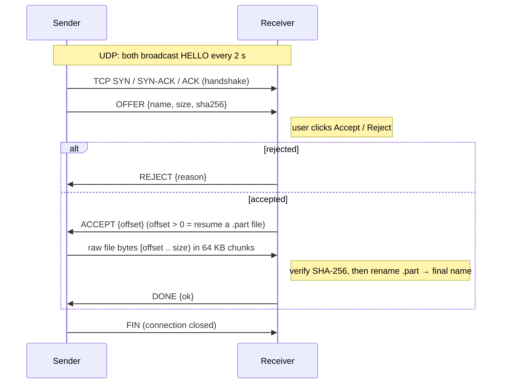

# DropZone

A minimal AirDrop-style file sharer for any OS on a local network. Each machine runs a
small Python node: peers find each other with **UDP broadcast**, files move over **TCP**,
and you control it all from a web page on `127.0.0.1`. A built-in **network inspector**
shows every UDP beacon and TCP control message as it happens.

```
dropzone/protocol.py   framing (length-prefix + JSON), validation, filename sanitising
dropzone/discovery.py  UDP beacons, peer table
dropzone/transfer.py   TCP server (receive) and send_file (send)
dropzone/web.py        FastAPI: page, WebSocket events, upload endpoint
dropzone/main.py       config, wiring, CLI
static/                the UI (plain HTML/CSS/JS)
```

## Why UDP for discovery, TCP for transfer

| | UDP (discovery, port 50000) | TCP (transfer, port 50001) |
|---|---|---|
| Need | "Who is out there?", sent to *everyone* | Move one file to *one* host, intact |
| Why | Supports **broadcast**; no connection setup; a lost beacon doesn't matter because another one follows | **Reliable, ordered, flow-controlled** byte stream; retransmits lost segments; a connection per transfer |
| Cost | No delivery guarantee | Handshake + per-connection state |

TCP cannot broadcast, and rebuilding reliability on top of UDP for a 2 GB file would
mean re-implementing TCP. So each protocol does the job it is good at.

## Protocol

**Discovery (UDP broadcast to `255.255.255.255:50000`)**, every 2 s (`--beacon-interval`):
```json
{"type":"HELLO","id":"5e22d0488f27","name":"Host A","tcp_port":50001,"ver":1}
```
A peer that misses 3 beacons (6 s) is marked offline. When a node hears a peer it doesn't know yet,
it answers with one HELLO right away, so new nodes appear immediately. On shutdown a node sends
`{"type":"BYE","id":...}`. The peer's IP comes from the UDP packet's source address.

**Transfer (TCP)**: control messages are framed because TCP has no message boundaries:
```
+----------------------+---------------------------+
| length (4 bytes, BE) | JSON body (<= 64 KB)      |
+----------------------+---------------------------+
```



## Security

- The web UI binds to `127.0.0.1` by default and refuses cross-origin requests and WebSockets.
- Every transfer must be accepted by the receiver. Nothing is written to disk before that.
- File names are reduced to a bare name (`../../x` → `x`). Files are written only inside the
  download folder and never overwrite an existing file (`a.txt` → `a (1).txt`).
- Control messages over 64 KB and files over `--max-size` (default 2 GB) are rejected.
  Every JSON field is type- and range-checked. Malformed UDP packets are silently ignored.
- TCP reads time out after 30 s. Files are streamed in 64 KB chunks and never held in memory.
- Only `json` touches network data (no pickle/eval/shell).
- The preview endpoint (`/api/files/<name>`) serves only finished files from the download folder
  (never `.part`, never outside it), with `Content-Security-Policy: sandbox` so a received HTML/SVG
  file can't run scripts against the UI.
- Data goes into `name.<hash>.part` and is renamed only after the SHA-256 matches. On a
  dropped connection the `.part` is kept for resume; on a hash mismatch it is deleted.
- Not in scope: encryption and authentication. Anyone on the LAN can see the traffic and
  send offers (which you can still reject).

## Run it

Requires Python 3.11+.

```bash
python3 -m venv .venv && source .venv/bin/activate
pip install -r requirements.txt
python -m dropzone.main --name "Host A"      # UI at http://127.0.0.1:8000
```

To run two nodes on one machine, give the second its own TCP and web port (the UDP port is
shared thanks to `SO_REUSEPORT`):
```bash
python -m dropzone.main --name "Host B" --tcp-port 50002 --web-port 8010 --downloads downloads-b
```

| Option | Env var | Default |
|---|---|---|
| `--name` | `DZ_NAME` | `Host <random letter>` |
| `--udp-port` | `DZ_UDP_PORT` | 50000 |
| `--tcp-port` | `DZ_TCP_PORT` | 50001 |
| `--downloads` | `DZ_DOWNLOADS` | `./downloads` |
| `--web-host` / `--web-port` | `DZ_WEB_HOST` / `DZ_WEB_PORT` | 127.0.0.1 / 8000 |
| `--max-size` | `DZ_MAX_SIZE` | 2147483648 (bytes) |
| `--beacon-interval` | `DZ_BEACON_INTERVAL` | 2 (seconds) |
| `--broadcast` | `DZ_BROADCAST` | 255.255.255.255 |

There is also a CLI without the web UI:
```bash
python -m dropzone.main --tcp-port 50001 recv           # asks "Accept? [y/N]" in the terminal
python -m dropzone.main send 192.168.1.20:50001 photo.jpg
```

### Docker: 3 nodes on one virtual LAN

```bash
docker compose up --build
```
Open http://127.0.0.1:8001 (Host A), http://127.0.0.1:8002 (Host B) and http://127.0.0.1:8003 (Host C). Each node lists
the other two within a second or two. Pick a peer, drop a file, and accept it in the receiver's tab.

- **Online / Offline**: click the status pill in the orange header. *Offline* broadcasts BYE, stops
  the beacons, closes the TCP listener and declines waiting offers, so the other hosts grey it out.
  *Online* starts it all again. Handy for showing BYE/HELLO and a refused TCP connection in Wireshark.
- **Preview**: finished transfers get a Preview button. Images, video, audio, PDF and text open in
  a dialog. A sent file is previewed from the browser's own copy (only until the tab is reloaded);
  a received file is read from the host's download folder.
- **Technical details**: the `</>` pill hides or shows the inspector, IPs/ports, ids, hashes and
  protocol labels. The choice is remembered per browser.

Received files appear in the project folder, one folder per host:
`received/host-a/`, `received/host-b/`, `received/host-c/` (mounted as `/downloads` in each container).
A file only appears there under its real name after its SHA-256 has been verified; a `*.part`
file is still arriving or was interrupted. To double-check a transfer:
```bash
shasum -a 256 received/host-b/photo.jpg ~/Desktop/photo.jpg   # the two hashes must match (Linux: sha256sum)
docker compose down                                          # stop (BYE is sent)
```
On Linux, if the containers can't write there, run `chmod 777 received/*` (the container runs as an
unprivileged user that may not own the folders).
Broadcasting to `255.255.255.255` works on a Docker bridge network as is, so no subnet
broadcast address is needed. If your network drops limited broadcasts, set
`DZ_BROADCAST` to the subnet broadcast (e.g. `192.168.1.255`).

## Tests

```bash
pytest -v
```
Covers framing round-trip (with the stream split into 3-byte pieces), oversized and
malformed messages, read timeouts, filename sanitisation, beacon validation, full localhost
transfers with hash check, resume from a partial file, reject/too-large (nothing written),
path traversal, no-overwrite, corrupt partials, a stalled sender, and a receiver that sends a
bogus offset.

## Wireshark screenshots

**Easiest:** two computers on the same Wi-Fi, each running `python -m dropzone.main`.
Capture on the Wi-Fi interface with the capture filter `udp port 50000 or tcp port 50001`.
(Two nodes on *one* machine: UDP beacons appear on Wi-Fi/Ethernet, while the TCP transfer
goes over the loopback interface `lo0`/`lo`.)

**Docker:** capture inside Host A's (service `node1`) network namespace and open the file in Wireshark:
```bash
docker run --rm --net container:dropzone-node1-1 nicolaka/netshoot \
  tcpdump -i eth0 -w - 'udp port 50000 or tcp port 50001' > dropzone.pcap
```

Screenshots worth taking:

| What | Display filter | What to point out |
|---|---|---|
| UDP beacons | `udp.port == 50000` | dst `255.255.255.255` / `ff:ff:ff:ff:ff:ff`, every ~2 s (plus an immediate reply when a node starts); JSON HELLO in the payload |
| TCP handshake | `tcp.port == 50001 && tcp.flags.syn == 1` | SYN → SYN-ACK → ACK before the OFFER |
| Control framing | `tcp.port == 50001 && tcp.len < 300` | 4-byte length + `{"type":"OFFER"...}`; *Follow → TCP Stream* shows OFFER/ACCEPT/DONE |
| Data + flow control | `tcp.port == 50001` | full-size segments, ACKs, window size (*Statistics → TCP Stream Graphs*) |
| Teardown | `tcp.port == 50001 && tcp.flags.fin == 1` | FIN/ACK from both sides after DONE |
| BYE | `udp.port == 50000` | stop a node with Ctrl-C: one `{"type":"BYE"}` broadcast |

The in-app **Network inspector** shows the same messages at application level, so you can put
a screenshot of it next to the Wireshark one.
